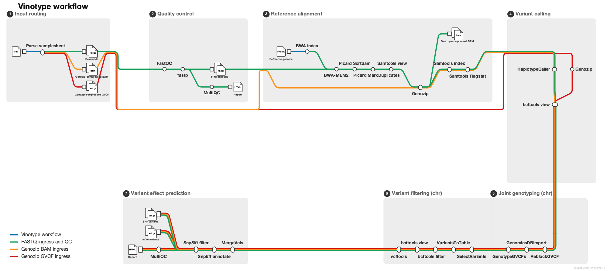

# dylangrblr/vinotype

[](https://github.com/dylangrblr/vinotype/actions/workflows/ci.yml)
[](https://github.com/dylangrblr/vinotype/actions/workflows/linting.yml)[](https://doi.org/10.5281/zenodo.XXXXXXX)
[](https://www.nf-test.com)

[](https://www.nextflow.io/)
[](https://docs.conda.io/en/latest/)
[](https://www.docker.com/)
[](https://sylabs.io/docs/)
[](https://cloud.seqera.io/launch?pipeline=https://github.com/dylangrblr/vinotype)

## Introduction

**dylangrblr/vinotype** is a streamlined bioinformatics pipeline for large-scale identification of sequence variants from Illumina paired-end short-read data targeting grapevine (_Vitis_ spp.). It accepts raw FASTQ files (or pre-processed Genozip-compressed BAM/gVCF files) and carries samples through read quality control, reference alignment, per-sample variant calling, joint genotyping, hard-filter variant refinement, and functional effect prediction — producing a fully annotated, filtered multi-sample VCF together with a comprehensive MultiQC report.



The pipeline implements the following steps:

1. **Quality Control** — Pre-trim read QC ([`FastQC`](https://www.bioinformatics.babraham.ac.uk/projects/fastqc/)), adapter trimming and quality filtering ([`fastp`](https://github.com/OpenGene/fastp)), post-trim read QC ([`FastQC`](https://www.bioinformatics.babraham.ac.uk/projects/fastqc/))
2. **Reference Indexing** — Build BWA-MEM2, samtools faidx, samtools dict, and optional Genozip reference indexes ([`BWA-MEM2`](https://github.com/bwa-mem2/bwa-mem2), [`SAMtools`](https://www.htslib.org/), [`Genozip`](https://www.genozip.com/))
3. **Reference Alignment** — Align trimmed reads to the reference genome, sort, add read groups, mark duplicates, filter, and flag alignment statistics ([`BWA-MEM2`](https://github.com/bwa-mem2/bwa-mem2), [`Picard`](https://broadinstitute.github.io/picard/), [`SAMtools`](https://www.htslib.org/))
4. **Variant Calling** — Call per-sample genomic variants in GVCF mode and split GVCFs by chromosome ([`GATK4 HaplotypeCaller`](https://gatk.broadinstitute.org/) / [`GATK4Spark HaplotypeCaller`](https://gatk.broadinstitute.org/), [`BCFtools`](https://www.htslib.org/))
5. **Joint Genotyping** — Reblock per-chromosome GVCFs, import into GenomicsDB, and jointly genotype all samples per chromosome ([`GATK4 ReblockGVCF`](https://gatk.broadinstitute.org/), [`GATK4 GenomicsDBImport`](https://gatk.broadinstitute.org/), [`GATK4 GenotypeGVCFs`](https://gatk.broadinstitute.org/))
6. **Variant Filtering** — Separate SNPs and INDELs, extract annotation metrics, and apply hard filters ([`GATK4 SelectVariants`](https://gatk.broadinstitute.org/), [`GATK4 VariantsToTable`](https://gatk.broadinstitute.org/), [`BCFtools`](https://www.htslib.org/), [`VCFtools`](https://vcftools.github.io/))
7. **Variant Effect Prediction** — Merge per-chromosome VCFs, annotate functional consequences, and apply consequence filters ([`GATK4 MergeVcfs`](https://gatk.broadinstitute.org/), [`SnpEff`](https://pcingola.github.io/SnpEff/), [`SnpSift`](https://pcingola.github.io/SnpEff/ss_introduction/))
8. **Aggregate QC** — Collate all QC metrics and software versions into a single interactive report ([`MultiQC`](http://multiqc.info/))

## Usage

> [!NOTE]
> If you are new to Nextflow and nf-core, please refer to [this page](https://nf-co.re/docs/usage/installation) on how to set-up Nextflow. Make sure to [test your setup](https://nf-co.re/docs/usage/introduction#how-to-run-a-pipeline) with `-profile test` before running the workflow on actual data.

### Samplesheet input

Prepare a CSV samplesheet describing your samples. The pipeline supports three input data types — raw FASTQ, Genozip-compressed BAM, and Genozip-compressed gVCF — and these can be mixed freely within a single run. Each row must have a `sample` name; fill in only the column(s) that apply and leave the rest empty.

`samplesheet.csv`:

```csv
sample,fastq_1,fastq_2,bam,gvcf
SAMPLE_A,sample_A_R1.fastq.gz,sample_A_R2.fastq.gz,,
SAMPLE_B,,,sample_B.bam.genozip,
SAMPLE_C,,,,sample_C.g.vcf.genozip
```

| Column    | Description |
| --------- | ----------- |
| `sample`  | Unique sample name. Spaces are not allowed. |
| `fastq_1` | Path to gzipped paired-end FASTQ file (read 1). Must end in `.fastq.gz` or `.fq.gz`. |
| `fastq_2` | Path to gzipped paired-end FASTQ file (read 2). Must end in `.fastq.gz` or `.fq.gz`. |
| `bam`     | Path to a Genozip-compressed BAM file (`.bam.genozip`). Bypasses QC and alignment steps. |
| `gvcf`    | Path to a Genozip-compressed per-sample gVCF file (`.g.vcf.genozip`). Bypasses all steps up to joint genotyping. |

### Running the pipeline

```bash
nextflow run dylangrblr/vinotype \
   -profile docker \
   --input samplesheet.csv \
   --fasta /path/to/reference.fa \
   --intervals_list /path/to/intervals.list \
   --outdir results
```

> [!WARNING]
> Please provide pipeline parameters via the CLI or Nextflow `-params-file` option. Custom config files including those provided by the `-c` Nextflow option can be used to provide any configuration _**except for parameters**_; see [docs](https://nf-co.re/docs/usage/getting_started/configuration#custom-configuration-files).

For a full description of all parameters see [`docs/usage.md`](docs/usage.md) or run the pipeline with `--help`.

### Key parameters

| Parameter | Description |
| --------- | ----------- |
| `--input` | Path to the input samplesheet CSV (required). |
| `--fasta` | Path to the reference genome FASTA file (required). Must be chromosome-scale. |
| `--intervals_list` | Path to a GATK-style intervals list used to parallelise variant calling by chromosome (required). |
| `--outdir` | Output directory for results (required). |
| `--skip_merged_analysis` | Skip joint genotyping, variant filtering, and effect prediction (per-sample GVCFs only). |
| `--skip_gatk4_haplotypecaller_spark` | Use standard GATK4 HaplotypeCaller instead of the Spark implementation. |
| `--use_genozip` | Enable Genozip compression/decompression for BAM and GVCF files. Requires `--genozip_license_file`. |
| `--genozip_license_file` | Path to a valid Genozip license file. |
| `--snpeff_db_name` | SnpEff database name for the target species (e.g. `Vitis_vinifera`). |
| `--base_genomicsdb` | Path to an existing GenomicsDB workspace to update incrementally. |

## Credits

dylangrblr/vinotype was originally written by @dylangrblr, @abhi18av.

We thank the following people for their extensive assistance in the development of this pipeline:

## Contributions and Support

If you would like to contribute to this pipeline, please see the [contributing guidelines](.github/CONTRIBUTING.md).

## Citations

<!-- If you use dylangrblr/vinotype for your analysis, please cite it using the following doi: [10.5281/zenodo.XXXXXX](https://doi.org/10.5281/zenodo.XXXXXX) -->

An extensive list of references for the tools used by the pipeline can be found in the [`CITATIONS.md`](CITATIONS.md) file.

This pipeline uses code and infrastructure developed and maintained by the [nf-core](https://nf-co.re) community, reused here under the [MIT license](https://github.com/nf-core/tools/blob/main/LICENSE).

> **The nf-core framework for community-curated bioinformatics pipelines.**
>
> Philip Ewels, Alexander Peltzer, Sven Fillinger, Harshil Patel, Johannes Alneberg, Andreas Wilm, Maxime Ulysse Garcia, Paolo Di Tommaso & Sven Nahnsen.
>
> _Nat Biotechnol._ 2020 Feb 13. doi: [10.1038/s41587-020-0439-x](https://dx.doi.org/10.1038/s41587-020-0439-x).
